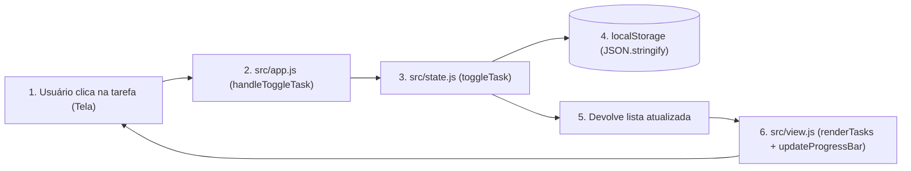

# 🌱 CareLog — Diário & To-Do List de Autocuidado

Bem-vindo(a) ao **CareLog**! Este projeto é uma **To-Do List gamificada de Autocuidado (Self-Care Tracker)** construída com **HTML5, CSS3 e JavaScript Puro (Vanilla JS)**, pensada especialmente como material de estudo para quem está aprendendo programação web moderna sem depender de frameworks ou bundlers.

Com uma estética **Pixel Art Clean & Cozy** (tons pastéis de verde sálvia, bege creme e lavanda suave), o CareLog transforma pequenas atitudes diárias de cuidado com o **Corpo**, a **Mente** e o **Ambiente** em "HP de Autocuidado do Dia".

---

## 🖼️ 1. Apresentação e Captura Conceitual da Interface

Ao abrir o **CareLog**, você encontra uma janela estilo RPG retrô aconchegante sobre um wallpaper em Pixel Art:

```text
+-----------------------------------------------------------------------+
|  [🌱] CareLog                                          [LVL 1 • COZY] |
|       Seu refúgio diário de autocuidado                               |
| - - - - - - - - - - - - - - - - - - - - - - - - - - - - - - - - - - - |
|  ✨ SABEDORIA DO DIA                                        [↻ Nova]  |
|  "Take time to know yourself."                                        |
|                                    Conselho #42 • via Advice Slip API |
|                                                                       |
|  💚 HP DE AUTOCUIDADO DO DIA                            1/3 (33% HP)  |
|  [██████████░░░░░░░░░░░░░░░░░░░░]                                     |
|  🍵 Bom começo! Cada pequeno gesto já faz diferença no seu bem-estar. |
|                                                                       |
|  [ 🌿 [Corpo] ▼ ] [ Alongar os ombros por 2 min...     ] [+ Adicionar]|
|                                                                       |
|  MISSÕES GENTIS DE HOJE                              Restaurar padrão |
|  +-----------------------------------------------------------------+  |
|  | [✓] [Corpo]    ~~Beber 1 copo d'água ao acordar.~~          [✕] |  |
|  +-----------------------------------------------------------------+  |
|  | [ ] [Mente]    Fazer 5 minutos de respiração sem telas.     [✕] |  |
|  +-----------------------------------------------------------------+  |
|  | [ ] [Ambiente] Organizar a mesa de trabalho no final do dia.[✕] |  |
|  +-----------------------------------------------------------------+  |
+-----------------------------------------------------------------------+
```

### Principais Funcionalidades
- **Barra de HP de Autocuidado**: Calcula automaticamente a porcentagem de tarefas concluídas no dia e exibe mensagens motivacionais.
- **Frase Inspiradora Diária (`fetch` + `async/await`)**: Consome a API pública e gratuita *Advice Slip* e possui **modo offline automático (fallback)** com frases locais em português caso você esteja sem internet.
- **3 Hábitos Padrão na Primeira Visita**: Se o `localStorage` estiver vazio, o app carrega automaticamente 3 missões leves para `[Corpo]`, `[Mente]` e `[Ambiente]`.
- **Persistência no Navegador (`localStorage`)**: Suas tarefas continuam salvas mesmo se você fechar a aba ou reiniciar o computador.

---

## 🗂️ 2. Arquitetura Modular e Fluxo de Dados (Separation of Concerns)

Em vez de colocar todo o JavaScript misturado em um único arquivo gigante, dividimos o código por **responsabilidade**. Pense na nossa aplicação como uma pequena equipe onde cada arquivo faz **apenas um trabalho muito bem feito**:

```text
carelog/
├── index.html      -> Estrutura semântica (<header>, <main>, <section>, <form>, <ul>)
├── style.css       -> Visual Pixel Art Cozy, variáveis (:root) e animações retrô
├── README.md       -> Documentação didática do projeto
└── src/
    ├── state.js    -> Cérebro dos Dados: lê e grava tarefas no localStorage
    ├── view.js     -> Desenhista da Tela: cria os <li> no DOM e atualiza a barra de HP
    ├── api.js      -> Mensageiro da Internet: busca a frase do dia com fetch() e try/catch
    └── app.js      -> Maestro (Controlador): escuta os cliques do usuário e conecta tudo!
```

### 🔄 Como um clique na tela altera o `state.js`, o `localStorage` e a `view.js`?

Para entender como aplicações web profissionais funcionam, acompanhe o caminho que a informação percorre quando você **clica em uma tarefa para marcá-la como concluída**:



1. **O Clique na Tela (`view.js` -> `app.js`)**:
   Quando o `view.js` desenha cada item `<li>`, ele coloca um ouvinte de clique (`addEventListener('click', ...)`). Quando você clica na tarefa `"Beber 1 copo d'água"`, ele avisa a função `handleToggleTask(id)` que está no `src/app.js`.
2. **O Maestro chama o Estado (`app.js` -> `state.js`)**:
   O `app.js` chama `toggleTask(id)` dentro de `src/state.js`.
3. **Atualização dos Dados e do `localStorage` (`state.js`)**:
   - O `state.js` lê as tarefas atuais do `localStorage` usando `JSON.parse()` (que transforma texto em Array de objetos).
   - Usa o método `.map()` para encontrar a tarefa com aquele `id` e inverte a propriedade `completed` (de `false` para `true` usando `!tarefa.completed`).
   - Converte a nova lista em texto com `JSON.stringify()` e salva no navegador com `localStorage.setItem()`.
   - Devolve a lista atualizada para o `app.js`.
4. **Redesenho da Tela (`app.js` -> `view.js`)**:
   - O `app.js` entrega a lista atualizada para a função `renderTasks()` dentro do `src/view.js`.
   - O `view.js` limpa a `<ul>`, recria os elementos `<li>` com `document.createElement()`, adiciona a classe `.is-completed` (que risca o texto e pinta o botão de verde) e chama `updateProgressBar()`, fazendo a barra de **HP de Autocuidado** subir!

> **Por que esse fluxo é tão importante?**
> Porque a tela **sempre reflete os dados reais**. Nunca alteramos apenas o visual esquecendo de salvar no `localStorage`, e nunca salvamos no `localStorage` esquecendo de atualizar a barra de progresso!

---

## 🚀 3. Guia de Execução Local

Como o projeto utiliza **Módulos ES6 nativos** (`<script type="module" src="src/app.js">` com `import` e `export`), os navegadores modernos exigem que os arquivos sejam abertos por um servidor local (`http://localhost...`) por questões de segurança (política de CORS), em vez de dar dois cliques direto no arquivo (`file://`).

Veja duas formas super simples de rodar no seu computador:

### Opção A: Usando a extensão Live Server no VS Code (Recomendado para Iniciantes)
1. Abra a pasta do projeto no **Visual Studio Code** (ou Antigravity).
2. Na aba de Extensões, procure por **Live Server** (de *Ritwick Dey*) e clique em **Install**.
3. Clique com o **botão direito** no arquivo `index.html` e selecione **"Open with Live Server"**.
4. O navegador abrirá automaticamente (geralmente em `http://127.0.0.1:5500`) com o **CareLog** pronto para uso!

### Opção B: Usando o Terminal (Python ou Node.js)
Se você já tem Python ou Node instalados na máquina, abra o terminal na pasta do projeto e rode **um** dos comandos abaixo:

```bash
# Com Python 3:
python -m http.server 8000

# Ou com Node.js (npx):
npx serve .
```
Depois, basta abrir o navegador e acessar `http://localhost:8000`.

---

## 💡 Conceitos de JavaScript que você aprende lendo este código

Todos os arquivos possuem comentários explicativos em português detalhando:
- **`evento.preventDefault()`** em `src/app.js`: como impedir que o envio do `<form>` recarregue a página.
- **`JSON.stringify()` e `JSON.parse()`** em `src/state.js`: por que precisamos converter arrays e objetos em texto para guardá-los no `localStorage`.
- **Métodos de Array (`.map()` e `.filter()`)** em `src/state.js` e `src/view.js`: como transformar listas e filtrar itens sem complicação.
- **`document.createElement()` e `.textContent`** em `src/view.js`: como criar elementos HTML com segurança pelo JavaScript.
- **`async / await` e `try / catch`** em `src/api.js`: como buscar dados de uma API externa na internet sem congelar a tela e garantindo um plano B caso o usuário esteja sem conexão.
